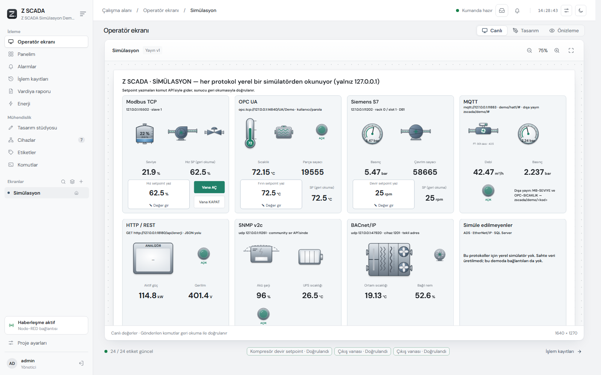
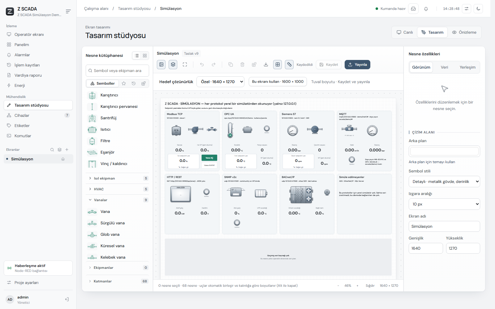
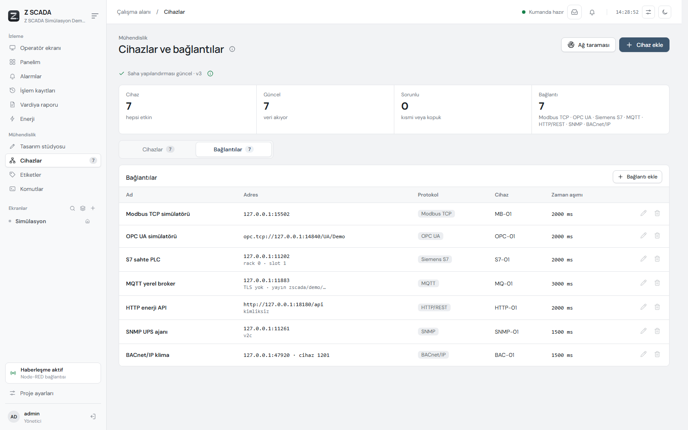
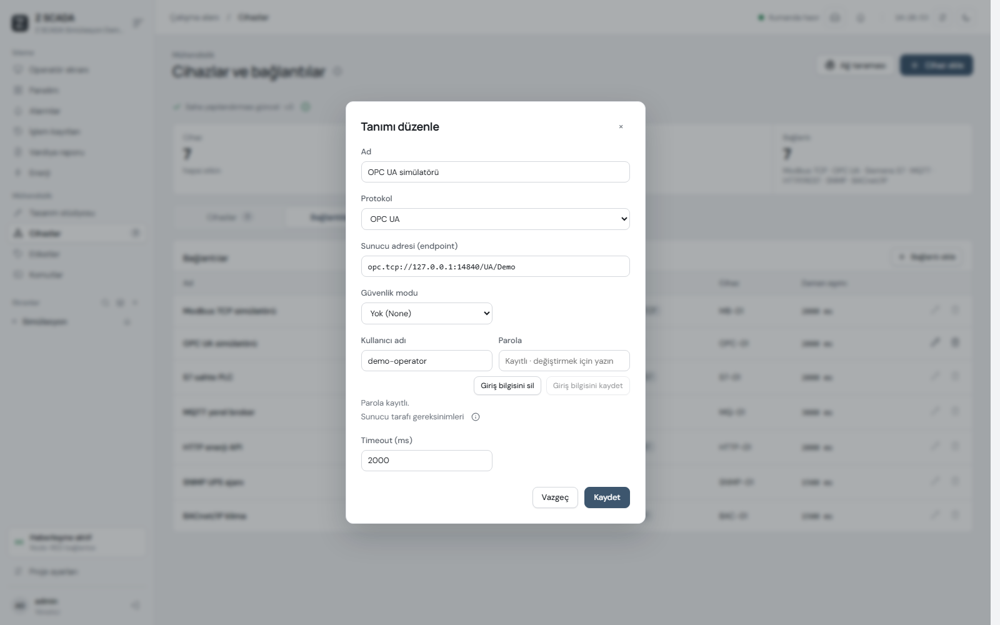
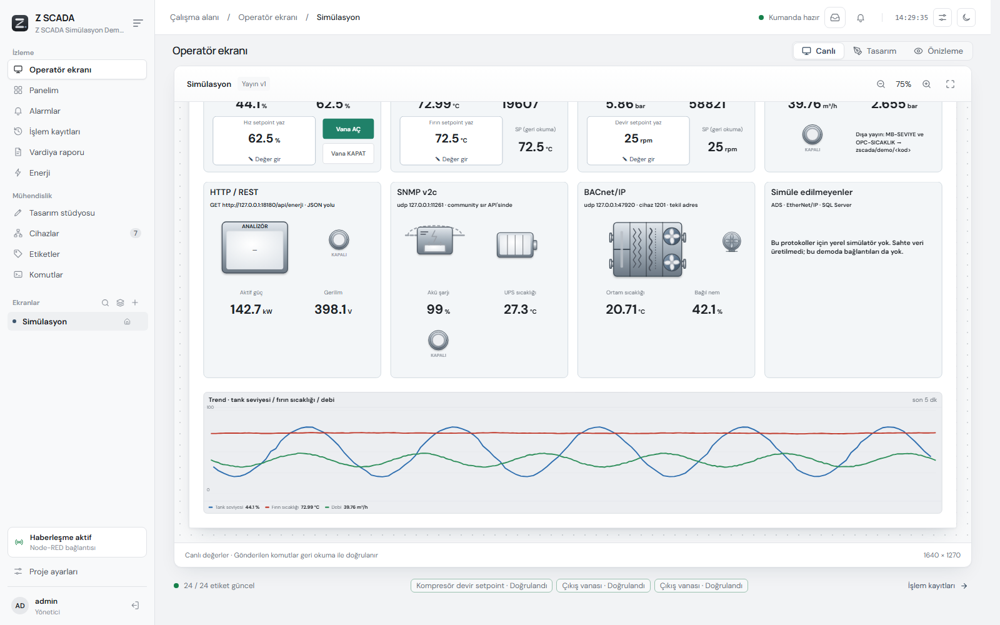
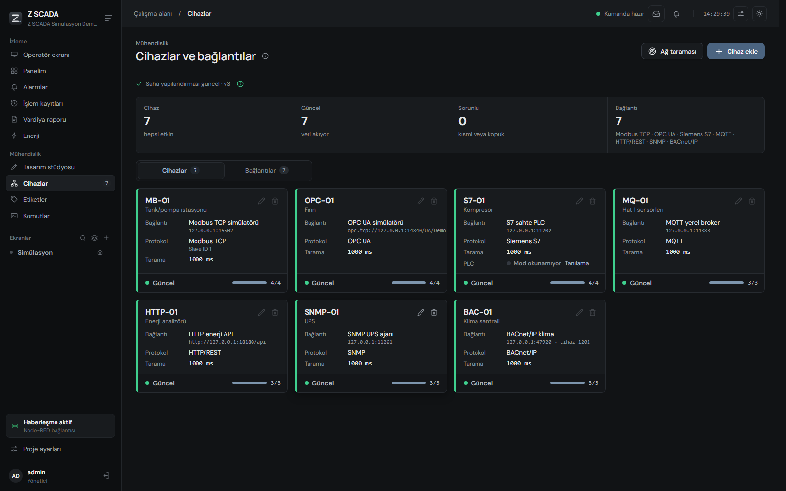
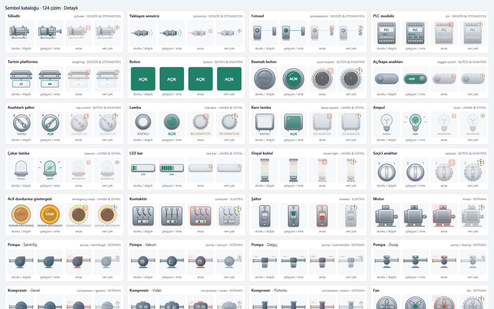
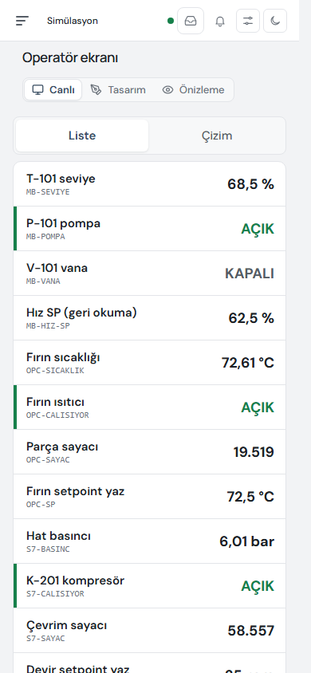

# Z SCADA

Endüstriyel PLC ve saha cihazları için web tabanlı, açık kaynak SCADA/HMI. Ekranlar tarayıcıda
tasarlanır ve izlenir; PLC haberleşmesini sunucunun ürettiği bir Node-RED köprüsü yürütür.
Komutlar yazmadan önce denetlenir, yazmadan sonra geri okumayla doğrulanır.

> English summary is at the end of this file.

## Kurulum (Windows .exe)

Node.js veya başka bir araç gerekmez; kurulum dosyası her şeyi içerir.

1. [GitHub Releases](https://github.com/canzayimler/Z-SCADA/releases/latest) sayfasından
   `Z-SCADA-Kurulum-<sürüm>.exe` dosyasını indirin.
2. Dosyaya çift tıklayın ve yönetici onayı verin. Kurulum dosyası imzasız olduğu için Windows
   SmartScreen "Windows bilgisayarınızı korudu" uyarısı gösterebilir: **Daha fazla bilgi** (bazı
   sürümlerde "Ek bilgi") → **Yine de çalıştır**. İsterseniz önce dosyanın SHA-256 değerini sürüm
   notlarındakiyle karşılaştırın: `Get-FileHash .\Z-SCADA-Kurulum-<sürüm>.exe`.
3. Z SCADA `C:\Program Files\Z SCADA` klasörüne kurulur ve **Windows servisi** (`ZScada`) olarak
   Windows ile birlikte başlar. Tepsi simgesi servisi izler; kurulum bitince arayüz açılır.
4. Arayüz: **http://localhost:4730** (yalnız bu bilgisayardan erişilir; Node-RED köprüsü
   `127.0.0.1:4731`). Port doluysa sıradaki boş port kullanılır.
5. **İlk giriş:** kullanıcı adı `admin`. Rastgele üretilen parola ilk açılışta
   `C:\ProgramData\DVP-SCADA\data\admin-access.json` dosyasına yazılır. Dosyayı yalnız yöneticiler
   okuyabilir (Not Defteri'ni "Yönetici olarak çalıştır" ile açın). Girişten sonra parolayı
   değiştirin ve dosyayı silin.

İlk açılışta örnek bir proje gelir; cihazlar pasif, ekranlar taslak başlar ve kurulum PLC'ye
komut göndermez. Veriler (ekranlar, ayarlar, kullanıcılar, geçmiş, loglar)
`C:\ProgramData\DVP-SCADA\data` altındadır (klasör adı, mevcut kurulumların yükseltilebilmesi için
ürünün eski adını korur). Yeni sürümün kurulum dosyasını çalıştırmak yerinde günceller ve verileri
korur.

**Kaldırma:** Ayarlar → Uygulamalar → Z SCADA → Kaldır (veya Başlat menüsü → "Z SCADA'yi Kaldir").
Servis durdurulup silinir; veri klasörünün silinip silinmeyeceği sorulur, varsayılan olarak korunur.

Kurulum dosyası bu depodaki kaynaktan `installer\build.ps1` ile üretilir; kendiniz derlemek için:
[installer/README.md](installer/README.md).

## Görseller / Screenshots

Tüm görüntüler yerel simülasyon demosundan alınmıştır; her protokol 127.0.0.1 üzerindeki bir
simülatörden okunur, gerçek saha cihazı yoktur.

| | |
|---|---|
|  |  |
| Operatör ekranı: yedi protokolden canlı değerler, geri okumayla doğrulanmış komutlar. | Tasarım stüdyosu: sembol kütüphanesi, tuval ve "Detaylı" sembol stili. |
|  |  |
| Bağlantılar: Modbus TCP, OPC UA, Siemens S7, MQTT, HTTP/REST, SNMP, BACnet/IP. | Bağlantı tanımı: OPC UA uç noktası, güvenlik modu ve kullanıcı/parola (kayıtlı parola gösterilmez). |
|  |  |
| Ekrana gömülü canlı trend: tank seviyesi, fırın sıcaklığı, debi. | Koyu tema: cihazlar ve haberleşme durumu. |
|  |  |
| Sembol kataloğu (Detaylı stil): her sembol durdu / çalışıyor / arıza / veri yok durumunda. | Mobil görünüm: operatör ekranı liste kipinde. |

## Özellikler

- **Ekran tasarım stüdyosu:** sürükle-bırak editör, tema duyarlı SVG sembol kütüphanesi
  (pompa, vana, tank, motor, boru, gösterge…), hizalama/katman, ekipman şablonları, taslak →
  yayın akışı, ekran sürüm geçmişi, ISA-101 uyumlu stil denetimi.
- **Operatör ekranı:** canlı değerler (WebSocket), komut butonları, seçici ve set değeri
  girişleri, kiosk modu, mobil uyumlu arayüz (PWA).
- **Komut güvenliği:** rol denetimi, bayat veri ve yapılandırma revizyonu kontrolü, izin
  koşulları (permissive), onaylı komutlar, değer aralığı sınırları, geri okumayla doğrulama.
- **Alarmlar:** eşik/durum kuralları, öncelik, onaylama yaşam döngüsü, alarm geçmişi.
- **Geçmiş ve raporlar:** etiket geçmişi, trend grafikleri, rapor ve CSV/Excel dışa aktarımı,
  saklama süresi yönetimi, enerji analizörü ekranları.
- **Mühendislik araçları:** cihaz/etiket/komut yönetimi, Excel/CSV etiket içe aktarımı (Delta DVP
  adres biçimi dahil), TIA Portal etiket tablosu içe aktarımı, OPC UA adres alanı gezgini, ağ
  tarama, reçeteler, kısıtlı betik (script) motoru.
- **Kullanıcılar ve denetim:** `admin`, `designer`, `operator`, `viewer` rolleri; her yazma ve
  yapılandırma değişikliği işlem kaydına düşer.
- **Yedeklilik:** aynı veri klasöründe tek yazıcı garantisi, aktif/pasif sunucu (kira + epoch
  ile fencing).

### Protokoller

| Protokol | Okuma | Yazma | Not |
|---|:---:|:---:|---|
| Modbus TCP | ✔ | ✔ | Coil, discrete input, holding/input register; sıralı tarama ve veri yolu kilidi |
| Modbus RTU / ASCII (seri) | ✔ | ✔ | RS-485; Delta DVP varsayılanı ASCII 9600 7E1 |
| Siemens S7 (ISO-on-TCP) | ✔ | ✔ | S7-300, S7-1200, S7-1500; PUT/GET izni gerekir |
| OPC UA | ✔ | ✔ | Anonim veya kullanıcı/parola; Sign / SignAndEncrypt |
| Beckhoff ADS | ✔ | ✔ | Sembol adıyla (TwinCAT) |
| EtherNet/IP (CIP) | ✔ | ✔ | Logix (ControlLogix/CompactLogix), Omron NX/NJ etiketleri |
| MQTT | ✔ | — | Konu aboneliği, JSON yolu; ayrıca etiketleri bir broker'a yayınlama |
| SNMP v1/v2c/v3 | ✔ | — | Sayısal OID |
| HTTP / REST (JSON) | ✔ | — | Basic veya bearer kimlik doğrulama |
| SQL Server | ✔ | — | Yalnız tek `SELECT` sorgusu |
| BACnet/IP | ✔ | — | Tekil adresle ReadPropertyMultiple; Who-Is/yayın göndermez |

Yazma yalnız tabloda ✔ olan protokollerde ve "oku/yaz" olarak işaretlenmiş etiketlerde
mümkündür; diğerleri bilinçli olarak salt okunurdur.

## Mimari

```
Tarayıcı (React)  ──HTTP/WebSocket──>  SCADA sunucusu (Fastify + SQLite)
                                          │  köprü akışını üretir ve uygular
                                          ▼
                                       Node-RED köprüsü  ──>  PLC / cihazlar
```

| Katman | Ne yapar |
|---|---|
| `apps/server` | Fastify + SQLite (`node:sqlite`). Yapılandırma, ekranlar, kullanıcılar, komut yaşam döngüsü, alarmlar, geçmiş, canlı veri için WebSocket. |
| `apps/web` | React arayüz: tasarım stüdyosu, operatör ekranı, yönetim sayfaları. |
| `packages/contracts` | Ortak şema ve doğrulama (zod). Sunucu ve arayüz aynı kuralları kullanır. |
| `packages/drivers` | Protokol sürücüleri: yapılandırmadan Node-RED düğümleri üretir. |
| `packages/symbols`, `packages/screen-model` | Sembol kütüphanesi ve ekran modeli. |
| Node-RED | Yalnızca saha haberleşmesi. Akış sunucu tarafından üretilir, elle düzenlenmez; yönetim arayüzü yalnız 127.0.0.1'de ve parolayla açılır. |

## Hızlı başlangıç (kaynaktan)

Gereksinim: **Node.js 22.5 veya üstü**. Windows'ta geliştirilip test edilmiştir.

```powershell
npm ci
npm run build
.\baslat.ps1        # Node-RED köprüsü + SCADA sunucusu + ilk yönetici hesabı
```

Arayüz: http://localhost:3000 · Node-RED köprüsü: http://localhost:1880 (yalnız yerel).
İlk yönetici parolası rastgele üretilir ve `.local\admin-access.json` dosyasına yazılır; ilk
girişten sonra değiştirin.

Yalnız sunucuyu çalıştırmak için (köprüsüz, örneğin arayüz geliştirme):

```powershell
npm start           # SCADA sunucusu, varsayılan port 3000, veri klasörü .local/
npm run dev         # Vite geliştirme sunucusu (5173), API'yi 3000'e yönlendirir
npm test            # birim ve entegrasyon testleri
```

Kalıcı kurulum, otomatik başlatma, LAN/TLS profili ve yedeklilik için:
[KURULUM.md](KURULUM.md).

İlk açılışta örnek bir proje gelir (Modbus TCP, `192.0.2.15:502`; bu bir belgeleme
adresidir). Cihazlar sayfasından kendi PLC adresinizi girin ve **Haberleşmeye uygula** deyin.

## Güvenlik notları

- **Sır deposu:** bağlantı kimlik bilgileri (OPC UA/HTTP parolaları, SNMP community ve v3
  anahtarları, bearer token) yapılandırmaya, SQLite'a, proje dışa aktarımına, işlem kayıtlarına
  ve loglara girmez. Veri klasöründe ayrı bir dosyada, dosya izinleri daraltılarak tutulur; API
  bu değerleri yalnız yazar, hiçbir zaman geri döndürmez.
- **Yazma koruması:** yazma yalnız `admin` ve `operator` rollerinde çalışır. Hedef etiketin verisi
  bayatsa, köprüye uygulanmış yapılandırma revizyonu kayıtlı olanla uyuşmuyorsa, izin koşulları
  sağlanmıyorsa veya değer tanımlı aralığın dışındaysa komut reddedilir. Köprüdeki yazma
  bekçisi ayrıca köprü anahtarını, revizyonu, komut süresini, veri tazeliğini ve tekrarı (replay)
  yeniden denetler.
- **Geri okuma doğrulaması:** her yazmadan sonra değer PLC'den geri okunur; süre içinde
  doğrulanmazsa işlem `unverified` olarak kapanır ve kayda düşer. Kısmi çoklu yazmalar
  `partial` olarak işaretlenir ve otomatik tekrar oynatılmaz.
- **Ağ:** sunucu varsayılan olarak yalnız `127.0.0.1` üzerinde dinler. LAN erişimi için TLS'i
  bir ters vekilde sonlandırın (`SCADA_PROFILE=lan-tls`); ayrıntı KURULUM.md'de.
- Güvenlik açığı bildirimleri için lütfen herkese açık issue yerine depo sahipleriyle özel
  olarak iletişime geçin.

## Lisans

Z SCADA kaynak kodu [GNU Genel Kamu Lisansı, sürüm 3 veya (tercihinize göre) sonraki bir sürüm](LICENSE)
(**GPL-3.0-or-later**) ile lisanslanmıştır: yazılımı kullanabilir, değiştirebilir ve dağıtabilirsiniz;
dağıttığınız sürümün kaynak kodunu da aynı lisansla sunmanız gerekir.

Çalışma zamanı bağımlılıkları npm'den kurulur, bu depoda yer almaz ve kendi lisanslarını korur
(`node-red-contrib-s7`, `@st-one-io/nodes7` ve `node-red-contrib-cip-ethernet-ip` de
GPL-3.0-or-later'dır; MIT, BSD ve Apache-2.0 bağımlılıklar GPL-3.0 ile uyumludur). Tam liste:
[THIRD-PARTY-NOTICES.md](THIRD-PARTY-NOTICES.md).

"Siemens", "S7", "TIA Portal", "Beckhoff", "TwinCAT", "Delta", "Omron", "Rockwell",
"Logix" ve diğer ürün adları sahiplerinin ticari markalarıdır; yalnız uyumluluğu belirtmek için
kullanılır.

---

## English

**Z SCADA** is an open-source, web-based SCADA/HMI for industrial PLCs and field devices.
Screens are designed and operated in the browser; field communication runs through a Node-RED
bridge flow that the server generates. Commands are checked before writing and verified by
read-back afterwards.

- **Protocols:** read/write for Modbus TCP, Modbus RTU/ASCII, Siemens S7, OPC UA, Beckhoff ADS
  and EtherNet/IP (CIP); read-only for MQTT (plus publishing tags to a broker), SNMP, HTTP/REST,
  SQL Server (single `SELECT`) and BACnet/IP.
- **Architecture:** React web UI ⇄ Fastify + SQLite server ⇄ generated Node-RED bridge ⇄ devices.
- **Windows installer:** download `Z-SCADA-Kurulum-<version>.exe` from
  [Releases](https://github.com/canzayimler/Z-SCADA/releases/latest) and run it (unsigned: in
  SmartScreen choose "More info" → "Run anyway"). It installs as the Windows service `ZScada` and
  serves http://localhost:4730; the first `admin` password is written to
  `C:\ProgramData\DVP-SCADA\data\admin-access.json` (readable by administrators only). Uninstall from
  Settings → Apps. Build it yourself with `installer\build.ps1` (see `installer/README.md`).
- **Quick start from source:** Node.js 22.5+, then `npm ci`, `npm run build`, `.\baslat.ps1` (Windows) or
  `npm start` for the server alone. UI at http://localhost:3000. See `KURULUM.md` (Turkish) for
  service install, TLS and redundancy.
- **Security:** connection secrets live in a separate permission-restricted file and are never
  returned by the API or exported; writes require the `admin`/`operator` role, fresh data and a
  matching deployed revision; every write is verified by read-back and audited. The server
  listens on 127.0.0.1 by default.
- **License:** GPL-3.0-or-later: you may use, modify and redistribute Z SCADA, provided that you
  offer the source code of any distributed version under the same license. Runtime npm
  dependencies are not part of this repository and keep their own GPL-compatible licenses; see
  `THIRD-PARTY-NOTICES.md`.

The user interface and most code comments are in Turkish.
